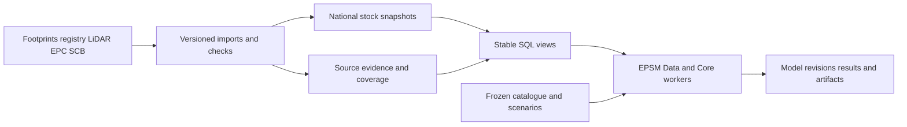

# National UBEM database design and starter

This starter defines a proposed PostgreSQL and PostGIS foundation for the Swedish national building stock, its source evidence, EPSM catalogue releases and future renovation studies. It provides a query contract and deployment template. The source importers, complete publication gates and national worker service still need implementation; the national records have not been loaded into this database.

The central decision is to retain every physical building in a versioned stock snapshot, attach sparse source evidence without changing that population, and expose ordinary typed columns through stable SQL views. A published study pins one stock snapshot and one set of catalogue, code, weather and scenario versions.

## Data organisation

Use one database, `epsm_stock`, with schemas separating responsibilities. These schemas support joins within the same database. PostgreSQL documents this organisation in [Schemas](https://www.postgresql.org/docs/current/ddl-schemas.html).

| Schema | Responsibility | Examples |
|---|---|---|
| `meta` | Sources, releases, assets, variable definitions, policies and default snapshot | Publisher, reference date, raw file URI and SHA-256 |
| `stock` | Physical building identities, versioned footprints, complete stock snapshots and selected field lineage | One row per snapshot and building |
| `geo` | Versioned administrative and statistical areas, building assignments and area context observations | County, municipality, RegSO, DeSO, population grid |
| `epc` | Certificates, their building relationships and scoped energy observations | Measured period, energy carrier, end use, heated-area scope |
| `library` | Frozen EPSM Data releases and archetype records | Catalogue JSON, six-era definitions, constructions and profiles |
| `model` | Scenarios, measures, resolved building revisions and simulation runs | Validated BuildingSpec, weather and compiler identity |
| `qa` | Processing scope, issues and coverage reports | Denominator definitions, failed joins, field completeness |
| `api` | Views for people and applications | `buildings`, `buildings_spatial`, `variable_dictionary` |

Raw source files belong in retained file or object storage, addressed by URI and checksum. Postgres stores queryable attributes, relations, selected evidence, compact manifests and annual results. Keep large LiDAR clouds, weather files and hourly simulation outputs in artifact storage, with their hashes registered in the database. A local directory is sufficient initially; the URI contract can later use object storage without changing building identity.



## Building identity and source selection

Preserve the existing national `objektidentitet` UUID as `building_id`. A building identifier is separate from its property, certificate and archetype. Retain source row IDs, object versions, validity dates and source aliases. Future building splits and merges require explicit predecessor and successor relations; geometry similarity alone must not silently reassign identity.

The current EPC, age and height pipelines identify buildings by that object ID, but they do not use identical rules to choose a footprint version. Municipality and use counts reconcile; that does not establish that the selected geometries are identical. Before publishing the first stock release, define one canonical footprint policy and check every geometry-dependent height, area and model input against its selected footprint version. The details and import gates are in [SOURCE_CONTRACT.md](SOURCE_CONTRACT.md).

`stock.footprint` stores a footprint once per source release and building. Stock snapshots reference this version; model scenarios reuse it. Preserve source geometry and document any repair or modelling simplification separately. Keep the metric national CRS, EPSG:3006, for spatial work; a CRS label does not transform coordinates for Core.

The complete national population starts from physical footprints. Missing registry, EPC or height attributes remain missing on those rows. A selected EPC cohort, a pure-programme cohort and a simulation cohort are separately defined subsets. National office coverage remains unknown until a defensible office inventory is defined; the broad GIS `Verksamhet` category has its own `business_proxy` classification.

## Clear variable names

Use English `snake_case`, explicit physical definitions and unit suffixes. Store counts as integers, codes as strings and dates as dates. Keep raw Swedish source names in the mapping dictionary. Main filters and model inputs are ordinary columns; JSON is used for source details, alternatives and native specifications.

| Canonical name | Meaning |
|---|---|
| `primary_use_code` | Selected primary GIS use, under a versioned classification policy |
| `epc_use_code` | EPC-reported programme; kept distinct from GIS use |
| `construction_year` | Selected construction year; registry and EPC alternatives remain traceable |
| `height_representative_m` | Pipeline representative height, with its exact estimator documented |
| `height_eave_m`, `height_ridge_m` | Separate eave and ridge heights |
| `storeys_above_ground` | Above-ground storey count |
| `heated_basement_storeys` | Reported or resolved heated basement storey count; zero differs from missing |
| `footprint_area_m2` | Area of the selected metric footprint |
| `heated_floor_area_atemp_m2` | Atemp for the explicitly resolved measurement scope |
| `ventilation_system_code` | Defined ventilation category; mixed and unsupported categories remain visible |
| `ventilation_design_flow_l_s_m2` | Design ventilation flow per reference area, with the area basis documented |
| `population_total` | Published population count in a specified grid or statistical area and year |
| `population_density_people_km2` | Population divided by the area defined by its source method |

Never replace a source income field with the vague name `income_median`. Confirm the SCB contents code, population, income concept, statistic, reference year and price basis first. Suitable names after verification include `earned_income_median_person_20plus_sek_year` or `earned_income_mean_person_20plus_sek_year`. Household disposable income needs a different variable. Store currency, price year and source units, including any tkr-to-SEK conversion. This audit has not verified the archived income contents-code mapping, so its canonical statistic is an import gate.

The variable dictionary should document description, unit, value type, allowed categories, area or volume reference basis, source mappings, valid ranges and missing-value interpretation. SQL `COMMENT` entries document the main tables and columns; `api.variable_dictionary` exposes the machine-readable dictionary. Generate the readable variable catalogue from this dictionary during each publication rather than maintaining two independent definitions.

## Provenance and completion

Keep two independent labels for each selected field:

- `evidence_origin`: reported, measured, derived, imputed or assumed.
- `field_status`: present, missing, conflicting, outside scope or not applicable.

A reported year can be present and conflict with another source. A derived height can have extraction flags. An imputed value can complete a model without increasing observed-data completeness. These distinctions survive into model revisions and coverage reports.

Trace a value through source release, source asset, source row locator, raw variable, transformation or selection policy, reference date and quality flags. Keep alternatives and the reason for selecting one. Shared file and transformation lineage belongs at release or batch level; avoid copying the same full manifest onto millions of rows. Per-building lineage records carry the field-specific references and exceptions. Benchmark this detail before scaling to hundreds of millions of provenance records.

Imputation and archetype defaults belong in a separate model revision or explicitly labelled completed snapshot. They must never overwrite imported observations. Predicted intervals refer to a pinned model and validation study; a missing interval is unknown confidence. Internal flags and source agreement do not establish a probability of correctness.

Published source releases and stock snapshots are immutable. Corrected data create new versions. A mutable `meta.default_snapshot` pointer provides convenient default queries, while papers and national runs always specify `snapshot_id`. The starter includes mutation guards, but the production publication procedure must also enforce all import gates and retain a signed or hashed publication manifest.

## Coverage and completeness

The database should produce its own counts after import. Every coverage report records the snapshot, variable, geographic and use grouping, population rule version, numerator, denominator, exclusions and calculation time. It must distinguish:

1. All national physical footprints.
2. Buildings with an accepted EPC link.
3. Buildings with an explicitly resolved single-building measurement scope.
4. Selected EPC study buildings.
5. Buildings inside a completed height-processing scope.
6. Attempted model assemblies and attempted simulations, including failures.

Report observed or derived availability, completed-model availability, conflicts, processing exclusions and validated prediction error separately. For joint availability, count buildings with all required fields directly. Unknown denominators, including current national office coverage, remain NULL rather than zero. A successful four-input intersection does not establish a complete BuildingSpec.

Boundary versions and observation years must be separate. RegSO and DeSO are statistical geographies. Income and population describe an area, not the occupants of each linked building. The SCB population grid contains confidentiality-protected counts that may not add exactly across age or sex groups; retain those source semantics in documentation.

The current paper aggregates and source hashes are in `output/national-completeness-paper-2026-10-05/data`. They are an acceptance reference for the relevant populations, not a replacement for row-level importing or proof that source geometry versions match.

## EPSM integration

Postgres stores catalogue data, assignments, assumptions, scenarios, resolved inputs, results and artifact references. EPSM Data and EPSM Core execute in versioned Python workers. Start by preserving Data's exact catalogue and layered-registry JSON payloads; normalize commonly queried entries while keeping the unchanged release payload available to existing loaders.

Each resolved model pins the stock snapshot, source selections, catalogue release, scenario, completion policy, weather content and effective code snapshot. Preserve full-spec checksum, Core physical hash and simulation run identity separately. Dirty Git checkouts require a file manifest or frozen code artifact in addition to the commit ID.

Renovation creates a new model revision with dated measures and a before/after audit. It does not edit baseline stock observations. Core's catalogue `existing`, `standard` and `advanced` states are alternative assignments, not automatically a sequential renovation path. [EPSM_ADAPTER.md](EPSM_ADAPTER.md) specifies the current public contracts and future worker handoff.

## Query and performance contract

Most users start from `api.buildings`; reproducible studies use `api.buildings_all_snapshots` with a snapshot filter. Geometry is available through `api.buildings_spatial`. Attribute lineage is in `stock.field_lineage`; the starter can later expose a dedicated evidence view with a stable interface. EPC measurements are queried through their explicit subject and link tables.

Index building identity, snapshot plus building, municipality plus use, construction year and accepted certificate relationships. Apply GiST indexes to geometries. Load sources in bounded batches with COPY, then build or validate indexes and run ANALYZE. Export cohorts once to Parquet for large worker campaigns, instead of querying the database once per building per scenario.

Nine million buildings do not by themselves require hundreds of municipality tables. Start with the typed tables and measure actual query plans. Add partitions to the large snapshot, observation or run tables when filtering and retention patterns justify them. Snapshot or run-batch partitions are candidates; excessive small partitions complicate planning and maintenance. See PostgreSQL's [partitioning guidance](https://www.postgresql.org/docs/current/ddl-partitioning.html).

A dedicated database service should use SSD storage, monitored disk and query performance, regular backups and a tested restore. Choose capacity from a pilot's measured data, index, WAL, temporary sort and retained-snapshot sizes. Keep simulation compute on workers so national runs do not consume the database server's CPU and memory.

## Local prototype

The template uses the upstream [PostGIS Docker image](https://github.com/postgis/docker-postgis), PostgreSQL 18 and PostGIS 3.6. Its documented volume location is `/var/lib/postgresql`. The default image is amd64, so Apple Silicon uses emulation; a Linux server or a verified native PostGIS image is preferable for the national import. Resolve and record the image digest before a reproducible deployment.

Create a local password file without putting the password into source control or command history:

```sh
cd database/national_stock
mkdir -p secrets
python3 -c 'import pathlib,secrets; p=pathlib.Path("secrets/db_password"); p.write_text(secrets.token_urlsafe(32)+"\n"); p.chmod(0o600)'
docker compose up -d
docker compose exec -T postgres psql -U epsm_owner -d epsm_stock -v ON_ERROR_STOP=1 -f /opt/epsm/schema/010_foundation.sql
docker compose exec -T postgres psql -U epsm_owner -d epsm_stock -v ON_ERROR_STOP=1 -f /opt/epsm/schema/020_spatial.sql
docker compose exec -T postgres psql -U epsm_owner -d epsm_stock -v ON_ERROR_STOP=1 -f /opt/epsm/schema/030_access.sql
```

These SQL files are initial migrations for an empty database and should be applied once in order. They do not import any national source. Changing Docker initialization variables does not modify an existing volume; future schema changes require new numbered migrations. The service binds to localhost on port 55432. The access migration creates reader, importer and worker group roles; assign actual login identities separately. Workers do not need source-ingest privileges. The prototype's owner credential should be confined to migrations and administrative work.

`docker compose stop` stops the service and preserves its volume. The production host, network access, authentication, backup location and artifact storage destination are deployment choices; the prototype does not decide these for a national service.

## Verification status

The relational foundation and access migrations were executed successfully against an isolated PostgreSQL 15.14 instance on 2026-10-05. `sql/050_smoke_test.sql` passed checks for retaining sparse stock rows, multi-footprint EPC area scope, missing/conflicting provenance, context types, publication counts, frozen source/snapshot/model records, unknown coverage denominators and role separation. All seven queries in `sql/040_example_queries.sql` also executed as `epsm_reader`. These query checks used an empty published API after the synthetic fixture rolled back; they verify syntax and permissions, not national query performance.

The Docker Compose configuration validates. PostGIS is not installed in the local validation server, and the local Docker daemon is not running, so `020_spatial.sql`, the PostgreSQL 18 container and spatial joins have not been executed here. `validation.json` records the exact file hashes, completed checks and limitations. The temporary validation server is stopped after these checks; it is not the national service.

After applying the migrations on the intended PostGIS host, run:

```sh
docker compose exec -T postgres psql -U epsm_owner -d epsm_stock -v ON_ERROR_STOP=1 -f /opt/epsm/schema/050_smoke_test.sql
docker compose exec -T postgres psql -U epsm_owner -d epsm_stock -v ON_ERROR_STOP=1 -c 'SET ROLE epsm_reader' -f /opt/epsm/schema/040_example_queries.sql
```

Before the national import, extend the pilot with real source records, polygon validity and repair cases, boundary assignments, geometry-version mismatches, EPC subject scope, source-row reimport behaviour and concurrent publication. The starter's minimal publication check does not substitute for those source and modelling acceptance gates.

## Implementation milestones

| Milestone | Deliverable and acceptance |
|---|---|
| 1. Freeze the contract | Agree building identity, canonical footprint policy, variable meanings and completeness populations; inspect this starter |
| 2. Import a pilot | 20-100 buildings containing missing fields, conflicting years, mixed use and multi-footprint EPCs; prove lineage and immutable publication |
| 3. Import one municipality | Reconcile full stock, registry, EPC and height counts; test spatial assignments and query performance |
| 4. Publish the national base | Import all physical stock, pin administrative/statistical geographies, fetch national SCB context, produce coverage documentation and verify restore |
| 5. Connect EPSM | Freeze catalogue/code, resolve validated BuildingSpecs, retain unresolved requirements and preparation failures |
| 6. Run renovation studies | Freeze scenarios and completion/imputation policies, dispatch workers, record attempts/results and evaluate uncertainty |

The immediate milestone is a reproducible national base release. A useful acceptance query should retrieve a building, its selected values, every value's lineage and its missing requirements without rebuilding joins from raw files. A second query should reproduce the national completeness tables by geography and use. National renovation results should then point back to this same frozen evidence.
